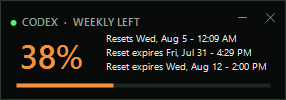

# CodexBar

[English](README.md) | **简体中文**

**一个小巧的 Windows 桌面组件，用于随时查看 Codex 与 Antigravity 的剩余额度。**

CodexBar 无需单独登录、API Key 或账户配置，会自动复用你已登录的 Codex 会话，并支持通过顶部标签栏（`CODEX · ANTIGRAVITY`）在同一个紧凑悬浮窗内切换查看 Antigravity 的各模型池余量。在 Codex 标签页中显示 5 小时与每周额度窗口的剩余百分比、下次重置时间以及可用重置次数过期时间；在 Antigravity 标签页中于客户端或 `agy` CLI 运行时展示各模型组的剩余百分比与重置时间，未运行时自动进入待机状态。小组件支持拖动，并可在最小化到 Windows 通知区域后继续更新。



## 功能亮点

- 无需额外登录或 API Key，自动复用现有 Codex 身份验证
- 支持单窗顶部 **`CODEX · ANTIGRAVITY` 标签切换**，Antigravity 视图会根据模型池数量自适应高度
- 显示 **Codex 5 小时和每周剩余额度**，以及 **Antigravity 各模型池剩余额度**
- 以本地日期和时间显示各个窗口的下次重置时间
- 显示所有可用 Codex 额度重置次数的准确过期日期和时间
- 未检测到 `Antigravity` 或 `agy` 运行时自动切换为**待机（Standby）**
- 托盘菜单内置 **Setup Antigravity CLI bridge…**，安全接入 `agy` 官方 `statusLine` 桥接而不覆盖已有自定义脚本
- 剩余额度降低时，颜色会从绿色变为黄色和红色
- 按可配置的时间间隔自动刷新
- 可最小化到 Windows 通知区域
- 小组件可见时显示任务栏按钮，隐藏到托盘时同时隐藏任务栏按钮
- 支持调节透明度和窗口置顶
- 支持随 Windows 自动启动
- 每周额度恢复为完全可用时，可发送电子邮件通知
- 通过 Codex 支持的本地 app-server 接口主动获取当前额度
- 依赖框架的 Windows 可执行文件约为 250 KB

## 使用方法

- **移动：**在小组件任意位置拖动。
- **任务栏：**小组件可见时，CodexBar 会显示在任务栏中。
- **最小化到托盘：**点击 `—`，隐藏小组件和任务栏按钮；CodexBar 会继续在通知区域更新。
- **恢复：**双击 CodexBar 通知区域图标，或在菜单中选择 **Show widget**。
- **托盘菜单：**右键点击小组件或通知区域图标。
- **关闭：**点击 `×` 会将 CodexBar 最小化到托盘，使其继续更新。
- **完全退出：**在托盘菜单中选择 **Exit**。

界面上的百分比表示对应窗口内仍然可用的额度。例如，Codex 报告 5 小时窗口已使用 10% 时，CodexBar 会显示该窗口剩余 **90%**。

## 设置

设置会在应用退出后保留。

| 设置 | 可选值 | 默认值 | 作用 |
|---|---|---:|---|
| 刷新间隔 | 5 秒、15 秒、30 秒、1 分钟、5 分钟 | 15 秒 | 控制 CodexBar 请求当前账户额度的频率。 |
| 透明度 | 100%、90%、80%、70%、60%、50% 不透明 | 90% | 调节整个小组件的不透明度。 |
| 始终置顶 | 开 / 关 | 开 | 让小组件保持在普通窗口上方。 |
| 随 Windows 启动 | 开 / 关 | 关 | 在当前用户的 Windows 启动项中添加或移除 CodexBar。 |
| 额度通知 | SMTP | 开，未配置 | 配置 SMTP 后，在检测到周额度用量恢复为零时发送一次提醒。 |
| 发送测试提醒 | — | — | 测试已配置的通知发送功能，不改变额度重置追踪状态。 |
| 立即刷新 | — | — | 立即请求当前账户额度。 |

设置保存在：

```text
%LOCALAPPDATA%\CodexBar\settings.json
```

## 通知

每周额度恢复为完全可用时，CodexBar 可以通过电子邮件通知你。在托盘菜单中打开 **Usage notifications…**，填写接收地址以及邮件服务商的 SMTP 信息。当 CodexBar 检测到周额度用量恢复为零时，会自动发送一次邮件。

如果移动运营商提供电子邮件转短信或彩信地址，你也可以通过这种方式接收短信提醒。请向运营商咨询，或在其官方支持网站搜索 **email-to-text gateway** 和你的套餐名称。此类地址通常由完整手机号码和运营商专用域名组成，但格式与可用性因运营商而异。请先使用普通邮件测试该地址，然后再使用 CodexBar 的 **Send test alert**。

使用 Gmail SMTP 时，请填写 `smtp.gmail.com`、端口 `587`，启用 SSL/TLS，并将完整 Gmail 地址作为 SMTP 用户名。Google 要求先启用两步验证，才能[创建 16 位应用专用密码](https://support.google.com/mail/answer/185833?hl=zh-Hans)；请在 CodexBar 中使用该应用专用密码，而不是 Gmail 登录密码。部分托管账户、仅使用安全密钥的账户或高级保护账户可能无法使用应用专用密码。

## 工作原理

CodexBar 使用计算机上已经完成身份验证的 Codex 安装：

1. 使用已安装的 Codex 可执行文件，在后台启动本地 `app-server`。
2. 按所选刷新间隔调用受支持的 `account/rateLimits/read` 方法。身份验证、令牌刷新和上游请求均由 Codex 负责。
3. 选择账户级 `codex` 额度，忽略单独的模型专用额度池。
4. 按窗口时长识别 5 小时（`300` 分钟）和 7 天（`10080` 分钟）额度，不依赖 Codex 将其放在 primary 还是 secondary 字段中。
5. 显示 `100 − used_percent`、每个窗口的重置时间，以及所有可用额度重置次数在本地时区的过期时间。

因此，CodexBar 不会抓取界面、自动操作浏览器、直接读取身份验证令牌，也不会维护第二套登录。默认刷新间隔为 15 秒，可在托盘菜单的 **Refresh interval** 中修改。每次刷新都会执行一次真实的、已通过身份验证的额度请求：例如选择 5 秒会每 5 秒请求一次，选择 5 分钟则每 5 分钟请求一次。如果请求失败，小组件会把最后一次成功获取的数据明确标记为 **Offline**，同时继续重试。

### Antigravity 监控

1. 安装官方 [Antigravity CLI（`agy`）](https://antigravity.google/docs/getting-started) 并运行一次 `agy` 完成登录。
2. 点击顶部标签栏的 **ANTIGRAVITY**（或在托盘菜单 **Active tab** 中切换）。
3. 只要 **Antigravity** 桌面端软件或 `agy` CLI 正在运行，CodexBar 就会在后台静默调用官方 `agy -p "/usage" --output-format json`（不创建对话、消耗 `0` token）自动同步各模型池剩余百分比与重置时间（默认每 30 秒缓存刷新，点击 **Refresh now** 立即刷新）；未检测到运行时自动显示为 **Standby** 待机状态。（托盘菜单仍保留可选的 `statusLine` 桥接配置作为兜底。）

## 隐私与安全

- 不要求或存储 Codex 凭据、访问令牌或 API Key。
- 所有已验证请求均交由官方本地 Codex app-server 处理，CodexBar 不会接触底层令牌。
- 只使用账户级额度窗口和额度重置过期时间元数据；不会读取对话内容或本地会话文件。
- 配置 SMTP 后，接收地址、服务器、端口和用户名会保存在本地设置 JSON 中。SMTP 密码使用当前 Windows 用户的 Data Protection API 加密，不会以明文写入文件。

## 安装

### 下载 Release

从最新 Release 下载以下任一 Windows x64 版本：

- [`CodexBar-win-x64.exe`](https://github.com/fangrui258/codex-bar/releases/latest/download/CodexBar-win-x64.exe) — 轻量版，需要安装 [.NET 10 Desktop Runtime](https://dotnet.microsoft.com/zh-cn/download/dotnet/10.0)。
- [`CodexBar-win-x64-portable.exe`](https://github.com/fangrui258/codex-bar/releases/latest/download/CodexBar-win-x64-portable.exe) — 自包含便携版，无需单独安装 .NET。

当前预编译 Release 仅提供 Windows x64 版本。Windows ARM64 用户可以使用下方命令从源码构建。

由于社区构建的可执行文件没有数字签名，Windows 可能显示 SmartScreen 警告。只有在确认文件来自可信 Release 后，才应选择 **更多信息 → 仍要运行**。

### 从源码构建

环境要求：

- Windows 10 或 Windows 11，x64 或 ARM64（源码构建）
- .NET 10 SDK 或更高版本
- 至少启动并使用过一次 Codex 应用或 CLI

使用 GitHub 的 **Code** 按钮克隆仓库，然后在 PowerShell 中运行：

```powershell
cd codex-bar
.\build.ps1
```

轻量版可执行文件会输出到 `dist\CodexBar.exe`。

如需将 .NET 运行时打包进体积更大的独立可执行文件：

```powershell
.\build.ps1 -Portable
```

在 Windows ARM 设备上构建：

```powershell
.\build.ps1 -Runtime win-arm64
```

### 运行回归检查

解析器检查使用不依赖第三方包的控制台测试工具，因此请运行仓库提供的测试入口，而不是 `dotnet test`：

```powershell
.\test.ps1
```

## 故障排查

### “Open Codex and sign in”

打开 Codex 并完成登录。CodexBar 会在下一次刷新时复用该身份验证会话。已安装的 Codex 版本必须支持 app-server 账户方法。

### 数字没有变化

选择 **Refresh now** 立即请求实时额度。如果小组件显示 **Offline**，请打开或更新 Codex，并确认已完成登录；CodexBar 会自动继续重试。

如果外部账户切换工具替换了 Codex 的 `auth.json`，CodexBar 会在下一次刷新时检测到变化，重启自己的 app-server 进程，并加载新账户的额度。如果只切换 Provider 并特意保留官方 Codex 登录，则 CodexBar 显示的 ChatGPT 额度所属账户不会改变。

### 小组件消失了

在 Windows 时钟附近的通知区域中查找 CodexBar 图标，包括折叠菜单中的图标。双击该图标即可恢复。只有选择 **Exit** 才会完全退出应用。

### 轻量版 EXE 提示需要 .NET

安装 [.NET 10 Desktop Runtime](https://dotnet.microsoft.com/zh-cn/download/dotnet/10.0)，或重新构建/下载便携版。

## 项目结构

```text
CodexBar.csproj          Windows Forms 项目配置
WidgetForm.cs            小组件界面、托盘菜单、绘制和刷新行为
CodexAppServerClient.cs  已验证的实时 Codex 额度客户端
UsageRateParser.cs       账户级 5 小时和周额度窗口解析器
AppSettings.cs           持久化设置和 Windows 启动项
build.ps1                轻量版与便携版发布脚本
test.ps1                 无第三方依赖的解析器回归检查
CHANGELOG.md              版本历史与发布说明
assets/                   产品截图和多尺寸 Windows 应用图标
```

## 限制

- 仅支持 Windows。
- 轻量版依赖 .NET 10 Desktop Runtime。
- 显示账户级 5 小时和周 Codex 额度，不显示单独的模型专用额度。
- 如果 Codex 没有为账户返回 5 小时窗口，小组件会将该行标记为不可用，同时继续显示周额度。
